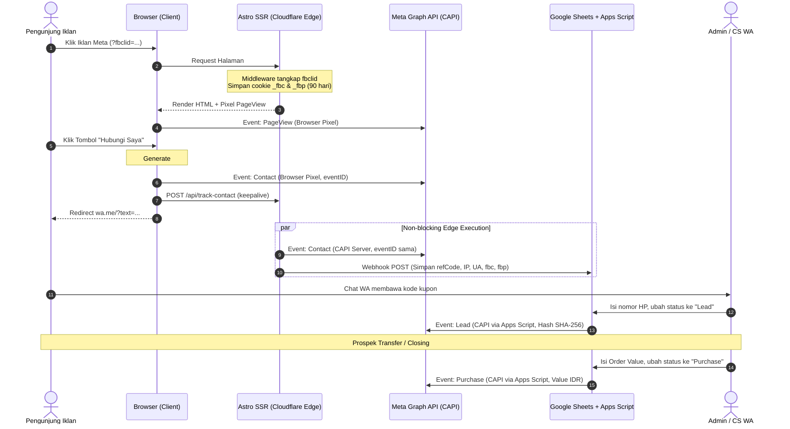

# Master Playbook: Meta Ads Hybrid Tracking
**Arsitektur: Astro SSR + Cloudflare Pages + Meta CAPI + Google Sheets Funnel**

Panduan lengkap dan siap pakai (copy-paste) untuk membangun sistem tracking iklan Meta Ads anti-ghost click (*anti klik bodong WhatsApp*) dengan verifikasi 4 tahap konversi:
$$\text{PageView} \longrightarrow \text{Contact} \longrightarrow \text{Lead} \longrightarrow \text{Purchase}$$

---

## 1. Alur Kerja Sistem (Architecture)



---

## 2. Dependensi & Konfigurasi Astro

### A. Install Adapter Cloudflare
```bash
npm install @astrojs/cloudflare
```

### B. `astro.config.mjs`
```javascript
import { defineConfig } from 'astro/config';
import cloudflare from '@astrojs/cloudflare';
import tailwindcss from '@tailwindcss/vite'; // opsional sesuai css framework

export default defineConfig({
  adapter: cloudflare(),
  // output default Astro adalah hybrid (static + dynamic via prerender = false)
});
```

### C. Landing Page (`src/pages/index.astro`)
Wajib pastikan halaman utama dieksekusi secara SSR agar middleware pembaca cookie berjalan:
```astro
---
export const prerender = false;
// ... component import
---
```

---

## 3. Server-Side Cookie Retention (`src/middleware.ts`)

Menangkap `fbclid` dari URL dan menguncinya ke cookie `_fbc` dan `_fbp` selama 90 hari (kebal terhadap iOS 14.5+ ITP).

Simpan di: `src/middleware.ts`
```typescript
import { defineMiddleware } from 'astro:middleware';

export const onRequest = defineMiddleware(async (context, next) => {
  const url = new URL(context.request.url);
  const fbclid = url.searchParams.get('fbclid');

  // 1. Tangkap fbclid -> set cookie _fbc
  if (fbclid) {
    const fbcValue = `fb.1.${Date.now()}.${fbclid}`;
    context.cookies.set('_fbc', fbcValue, {
      path: '/',
      maxAge: 7776000, // 90 hari
      secure: true,
      sameSite: 'lax',
      httpOnly: false, // Wajib false agar client JS bisa baca
    });
  }

  // 2. Jika _fbp belum ada di browser, generate server-side
  const existingFbp = context.cookies.get('_fbp');
  if (!existingFbp) {
    const randomInt = Math.floor(1000000000 + Math.random() * 9000000000);
    const fbpValue = `fb.1.${Date.now()}.${randomInt}`;
    context.cookies.set('_fbp', fbpValue, {
      path: '/',
      maxAge: 7776000,
      secure: true,
      sameSite: 'lax',
      httpOnly: false,
    });
  }

  return next();
});
```

---

## 4. Edge API Endpoint (`src/pages/api/track-contact.ts`)

Endpoint non-blocking di Cloudflare Edge untuk mengirim CAPI `Contact` dan logging ke Google Sheets secara paralel.

### Rule 2: Cloudflare Edge Execution & Runtime Env (Astro v6+ / @astrojs/cloudflare v14+)
- Set `export const prerender = false;` on API routes (`src/pages/api/track-contact.ts`).
- **STRICT RUNTIME COMPLIANCE:** DO NOT use `context.locals.runtime.ctx` or `context.locals.runtime.env` (deprecated and explicitly throws an Error in Astro v6).
- **Edge Non-blocking Tasks:** ALWAYS use `context.locals.cfContext.waitUntil(...)` for background execution when dispatching requests to Meta Graph API and Google Sheets Webhook, ensuring the client response returns immediately without killing the background tasks.
- **Local Dev Fallback:** If running in local Node dev mode where `context.locals.cfContext` is undefined, use `await` on the background tasks promise before returning the response.
- **Environment Variables Resolution:** Extract environment variables in order of priority:
  1. `context.locals.cfContext?.env?.[KEY]` (Cloudflare Worker production runtime)
  2. `process.env?.[KEY]` (Node environment)
  3. `import.meta.env?.[KEY]` (Astro build/Vite environment)
- **Visitor Context:** Extract real visitor IP from `request.headers.get('cf-connecting-ip')` (with fallback to `x-forwarded-for`) and User-Agent from `request.headers.get('user-agent')`.
- **Identifiers:** Read `_fbc`, `_fbp`, and `_gclid` from both cookies and request body fallback.

Simpan di: `src/pages/api/track-contact.ts`
```typescript
import type { APIRoute } from 'astro';

export const prerender = false;

function getEnv(key: string, cfContext?: { env?: Record<string, string | undefined> }): string | undefined {
  // 1. context.locals.cfContext?.env?.[KEY] (Cloudflare Worker production runtime)
  if (cfContext?.env?.[key]) {
    return cfContext.env[key]?.trim();
  }
  // 2. process.env (Node environment)
  if (typeof process !== 'undefined' && process.env?.[key]) {
    return process.env[key]?.trim();
  }
  // 3. import.meta.env (Astro build/Vite environment)
  const metaVal = (import.meta.env as Record<string, string | undefined>)[key];
  if (metaVal) {
    return metaVal.trim();
  }
  return undefined;
}

async function sendToMetaCAPI(params: {
  pixelId: string;
  accessToken: string;
  eventId: string;
  sourceUrl: string;
  clientIp: string;
  userAgent: string;
  fbc?: string;
  fbp?: string;
  refCode: string;
  testEventCode?: string;
}): Promise<void> {
  const url = `https://graph.facebook.com/v21.0/${params.pixelId}/events?access_token=${params.accessToken}`;

  const userData: Record<string, string> = {
    client_ip_address: params.clientIp,
    client_user_agent: params.userAgent,
  };
  if (params.fbc) userData.fbc = params.fbc;
  if (params.fbp) userData.fbp = params.fbp;

  const payload: Record<string, unknown> = {
    data: [
      {
        event_name: 'Contact',
        event_time: Math.floor(Date.now() / 1000),
        event_id: params.eventId,
        event_source_url: params.sourceUrl,
        action_source: 'website',
        user_data: userData,
        custom_data: { ref_code: params.refCode },
      },
    ],
  };

  if (params.testEventCode) {
    payload.test_event_code = params.testEventCode;
  }

  await fetch(url, {
    method: 'POST',
    headers: { 'Content-Type': 'application/json' },
    body: JSON.stringify(payload),
  });
}

async function sendToGoogleSheets(webhookUrl: string, data: Record<string, unknown>): Promise<void> {
  await fetch(webhookUrl, {
    method: 'POST',
    headers: { 'Content-Type': 'application/json' },
    body: JSON.stringify(data),
  });
}

export const POST: APIRoute = async (context) => {
  try {
    const body = await context.request.json().catch(() => ({}));
    const cfContext = (context.locals as {
      cfContext?: {
        env?: Record<string, string | undefined>;
        waitUntil?: (p: Promise<unknown>) => void;
      };
    })?.cfContext;

    const refCode = body.refCode || '';
    const eventId = body.eventId || `contact_${Date.now()}_${Math.random().toString(36).substring(2, 7)}`;
    const fbc = context.cookies.get('_fbc')?.value || body.fbc || undefined;
    const fbp = context.cookies.get('_fbp')?.value || body.fbp || undefined;
    const gclid = context.cookies.get('_gclid')?.value || body.gclid || undefined;
    const sourceUrl = body.sourceUrl || context.url.href;

    const clientIp =
      context.request.headers.get('cf-connecting-ip') ||
      context.request.headers.get('x-forwarded-for')?.split(',')[0]?.trim() ||
      '127.0.0.1';
    const userAgent = context.request.headers.get('user-agent') || '';

    const pixelId = getEnv('META_PIXEL_ID', cfContext);
    const accessToken = getEnv('META_ACCESS_TOKEN', cfContext);
    const googleSheetWebhookUrl = getEnv('GOOGLE_SHEET_WEBHOOK_URL', cfContext);
    const testEventCode = getEnv('META_TEST_EVENT_CODE', cfContext);

    const tasks: Promise<void>[] = [];

    if (pixelId && accessToken) {
      tasks.push(
        sendToMetaCAPI({
          pixelId,
          accessToken,
          eventId,
          sourceUrl,
          clientIp,
          userAgent,
          fbc,
          fbp,
          refCode,
          testEventCode,
        }).catch((err) => console.error('[Meta CAPI Contact Err]', err))
      );
    }

    if (googleSheetWebhookUrl) {
      tasks.push(
        sendToGoogleSheets(googleSheetWebhookUrl, {
          refCode,
          eventId,
          fbc: fbc || '',
          fbp: fbp || '',
          gclid: gclid || '',
          clientIp,
          userAgent,
          sourceUrl,
          status: 'Contact',
        }).catch((err) => console.error('[Google Sheets Err]', err))
      );
    }

    // Non-blocking Edge waitUntil execution di Cloudflare
    const backgroundPromise = Promise.all(tasks).then(() => {});

    if (cfContext && typeof cfContext.waitUntil === 'function') {
      cfContext.waitUntil(backgroundPromise);
    } else {
      // Fallback dev lokal (Node.js) di mana cfContext tidak ada
      await backgroundPromise;
    }

    return new Response(JSON.stringify({ success: true, refCode, eventId }), {
      status: 200,
      headers: { 'Content-Type': 'application/json' },
    });
  } catch (error) {
    return new Response(JSON.stringify({ success: false }), {
      status: 500,
      headers: { 'Content-Type': 'application/json' },
    });
  }
};
```

---

## 5. WhatsApp CTA Button Component (`src/components/WhatsAppCTA.astro`)

Simpan di: `src/components/WhatsAppCTA.astro`

> [!WARNING]
> **Aturan Penting Astro Script:**
> Karena script ini menggunakan `define:vars={{ testEventCode }}`, Astro meng-compile script ini sebagai **Inline Script**.
> **JANGAN gunakan tipe TypeScript** (`name: string`, `as HTMLElement`, dll) di dalam script ini karena browser tidak akan bisa mem-parse TypeScript mentah dan akan error. Gunakan **Plain JavaScript** murni.

```astro
---
interface Props {
  phoneNumber?: string;
  text?: string;
  class?: string;
}

const {
  phoneNumber = "6288971467723",
  text = "Hubungi Saya",
  class: customClass = ""
} = Astro.props;

const testEventCode = import.meta.env.META_TEST_EVENT_CODE || "";
---

<a
  href={`https://wa.me/${phoneNumber}`}
  target="_blank"
  rel="noopener noreferrer"
  class:list={["btn-whatsapp", customClass]}
  data-wa-phone={phoneNumber}
>
  {text}
</a>

<script define:vars={{ testEventCode }}>
  function getCookie(name) {
    const match = document.cookie.match(new RegExp("(^| )" + name + "=([^;]+)"));
    return match ? match[2] : undefined;
  }

  function generateRefCode() {
    const chars = "ABCDEFGHJKLMNPQRSTUVWXYZ23456789";
    let code = "";
    for (let i = 0; i < 4; i++) {
      code += chars.charAt(Math.floor(Math.random() * chars.length));
    }
    return `#REF${code}`;
  }

  function handleWhatsAppClick(e) {
    const target = e.currentTarget.closest("[data-wa-phone]");
    if (!target) return;

    e.preventDefault();

    const phoneNumber = target.getAttribute("data-wa-phone") || "6288971467723";
    const refCode = generateRefCode();
    const eventId = `contact_${Date.now()}_${Math.random().toString(36).substring(2, 8)}`;
    const fbc = getCookie("_fbc");
    const fbp = getCookie("_fbp");
    const sourceUrl = window.location.href;

    // 1. Browser Pixel Track (Deduplikasi via eventID)
    if (typeof window.fbq === "function") {
      const pixelOptions = { eventID: eventId };
      if (testEventCode) {
        pixelOptions.test_event_code = testEventCode;
      }
      window.fbq("track", "Contact", {}, pixelOptions);
    }

    // 2. Kirim ke Edge API (Non-blocking via keepalive)
    try {
      fetch("/api/track-contact", {
        method: "POST",
        headers: { "Content-Type": "application/json" },
        body: JSON.stringify({ refCode, eventId, fbc, fbp, sourceUrl }),
        keepalive: true,
      }).catch(() => {});
    } catch (_) {}

    // 3. Redirect ke WhatsApp dengan format voucher
    const message = `Halo Admin, saya mau ambil Promo Diskon via Website. (Mohon jangan hapus Kode Kupon: ${refCode} agar promo berlaku)`;
    const waUrl = `https://wa.me/${phoneNumber}?text=${encodeURIComponent(message)}`;

    window.open(waUrl, "_blank", "noopener,noreferrer");
  }

  function setupWhatsAppCTA() {
    document.querySelectorAll("[data-wa-phone]").forEach((btn) => {
      btn.removeEventListener("click", handleWhatsAppClick);
      btn.addEventListener("click", handleWhatsAppClick);
    });
  }

  setupWhatsAppCTA();
  document.addEventListener("astro:page-load", setupWhatsAppCTA);
</script>
```

---

## 6. Google Sheets & Apps Script Backend

### A. Format Kolom Google Sheets (Baris 1):
| A | B | C | D | E | F | G | H | I | J | K |
|---|---|---|---|---|---|---|---|---|---|---|
| **Timestamp** | **Ref_Code** | **Phone** | **fbc** | **fbp** | **Client_IP** | **User_Agent** | **Source_URL** | **Status** | **Order_Value** | **Notes** |

### B. Kode Google Apps Script (`Code.gs`)
Buka Spreadsheet > **Extensions > Apps Script**:
```javascript
const PIXEL_ID = "MASUKKAN_DATASET_ID";
const ACCESS_TOKEN = "MASUKKAN_CAPI_ACCESS_TOKEN";
const TEST_EVENT_CODE = ""; // Kosongkan saat live, isi saat testing misal "TEST67008"

function doPost(e) {
  try {
    const sheet = SpreadsheetApp.getActiveSpreadsheet().getActiveSheet();
    const data = JSON.parse(e.postData.contents);

    sheet.appendRow([
      new Date(),
      data.refCode || "",
      data.phone || "",
      data.fbc || "",
      data.fbp || "",
      data.clientIp || "",
      data.userAgent || "",
      data.sourceUrl || "",
      "Contact",
      "",
      "Saved from Web"
    ]);

    return ContentService.createTextOutput(JSON.stringify({ status: "success" }))
      .setMimeType(ContentService.MimeType.JSON);
  } catch (err) {
    return ContentService.createTextOutput(JSON.stringify({ error: err.toString() }))
      .setMimeType(ContentService.MimeType.JSON);
  }
}

function handleStatusEdit(e) {
  if (!e || !e.range) return;

  const range = e.range;
  const sheet = range.getSheet();
  const row = range.getRow();
  const col = range.getColumn();

  // Kolom 9 adalah Kolom "Status" (Kolom I)
  if (col === 9 && row > 1) {
    const statusVal = range.getValue();

    if (statusVal === "Lead" || statusVal === "Purchase") {
      const refCode = sheet.getRange(row, 2).getValue();
      const rawPhone = String(sheet.getRange(row, 3).getValue() || "");
      const fbc = sheet.getRange(row, 4).getValue();
      const fbp = sheet.getRange(row, 5).getValue();
      const clientIp = sheet.getRange(row, 6).getValue();
      const userAgent = sheet.getRange(row, 7).getValue();
      const sourceUrl = sheet.getRange(row, 8).getValue();
      const orderValue = sheet.getRange(row, 10).getValue();

      // Normalisasi Nomor HP ke format 628...
      let normalizedPhone = rawPhone.replace(/\D/g, "");
      if (normalizedPhone.startsWith("08")) {
        normalizedPhone = "62" + normalizedPhone.substring(1);
      } else if (normalizedPhone.startsWith("8")) {
        normalizedPhone = "62" + normalizedPhone;
      }

      sendCapiToMeta(statusVal, {
        refCode,
        phone: normalizedPhone,
        fbc,
        fbp,
        clientIp,
        userAgent,
        sourceUrl,
        orderValue: statusVal === "Purchase" ? Number(orderValue || 0) : undefined
      }, row, sheet);
    }
  }
}

function sendCapiToMeta(eventName, data, row, sheet) {
  const url = `https://graph.facebook.com/v21.0/${PIXEL_ID}/events?access_token=${ACCESS_TOKEN}`;

  const userData = {
    client_ip_address: data.clientIp || undefined,
    client_user_agent: data.userAgent || undefined,
    fbp: data.fbp || undefined,
    fbc: data.fbc || undefined,
  };

  if (data.phone) {
    userData.ph = [hashSHA256(data.phone)];
  }

  const eventItem = {
    event_name: eventName,
    event_time: Math.floor(Date.now() / 1000),
    action_source: "website",
    event_id: `${eventName.toLowerCase()}_${data.refCode}_${Date.now()}`,
    event_source_url: data.sourceUrl || undefined,
    user_data: userData
  };

  if (eventName === "Purchase") {
    eventItem.custom_data = {
      currency: "IDR",
      value: data.orderValue || 0
    };
  }

  const payload = { data: [eventItem] };
  if (TEST_EVENT_CODE) {
    payload.test_event_code = TEST_EVENT_CODE;
  }

  try {
    const res = UrlFetchApp.fetch(url, {
      method: "post",
      contentType: "application/json",
      payload: JSON.stringify(payload),
      muteHttpExceptions: true
    });
    const result = JSON.parse(res.getContentText());

    if (result.events_received) {
      sheet.getRange(row, 11).setValue(`${eventName} Berhasil (${result.events_received} evt)`);
    } else if (result.error) {
      sheet.getRange(row, 11).setValue(`Meta Err: ${result.error.message}`);
    }
  } catch (err) {
    sheet.getRange(row, 11).setValue(`Script Err: ${err.toString()}`);
  }
}

function hashSHA256(input) {
  const rawHash = Utilities.computeDigest(Utilities.DigestAlgorithm.SHA_256, input.trim().toLowerCase());
  return rawHash.map(b => (b < 0 ? b + 256 : b).toString(16).padStart(2, "0")).join("");
}
```

### C. Pasang Trigger di Apps Script (Wajib):
1. Buka icon jam (**Triggers**) di menu kiri Apps Script.
2. Klik **Add Trigger** (di kanan bawah).
3. Pilih fungsi: `handleStatusEdit`.
4. Event source: `From spreadsheet`.
5. Event type: `On edit`.
6. Simpan / izinkan permissions Google Account.

---

## 7. Setup Environment Variables

### A. Template `.env.example`
```env
META_PIXEL_ID=864721303383684
META_ACCESS_TOKEN=EAAv1W...
META_TEST_EVENT_CODE=
GOOGLE_SHEET_WEBHOOK_URL=https://script.google.com/macros/s/.../exec
```

### B. Setup di Cloudflare Pages Dashboard (Production):
Masuk ke **Workers & Pages > Project > Settings > Environment variables**:
Tambahkan:
- `META_PIXEL_ID`
- `META_ACCESS_TOKEN`
- `GOOGLE_SHEET_WEBHOOK_URL`
*(Biarkan `META_TEST_EVENT_CODE` kosong untuk mode live)*.

---

## 8. Checklist Eksekusi di Project Baru (Go-Live)

1. [ ] **Push ke Git:** Pastikan file `.env` masuk ke `.gitignore`.
2. [ ] **Input Env Cloudflare:** Masukkan credentials di dashboard Cloudflare Pages.
3. [ ] **Google Sheets Apps Script:**
   - Deploy as Web App (Access: Anyone).
   - Pasang Installable Trigger `handleStatusEdit` (On edit).
   - Pastikan `const TEST_EVENT_CODE = "";` kosong.
4. [ ] **Pancingan Aktivasi (1 Kali via HP):**
   - Akses website live di HP.
   - Klik tombol WhatsApp (membuka event `Contact` live).
   - Buka Google Sheets, isi nomor HP, ganti status jadi `Lead` (membuka event `Lead` live).
   - Ganti status jadi `Purchase` & isi nominal (membuka event `Purchase` live).
5. [ ] **Buka Meta Ads Manager:**
   - Masuk ke level Ad Set.
   - Dropdown Conversion Event (`Contact`, `Lead`, `Purchase`) sekarang aktif, berwarna hijau, dan siap digunakan!

